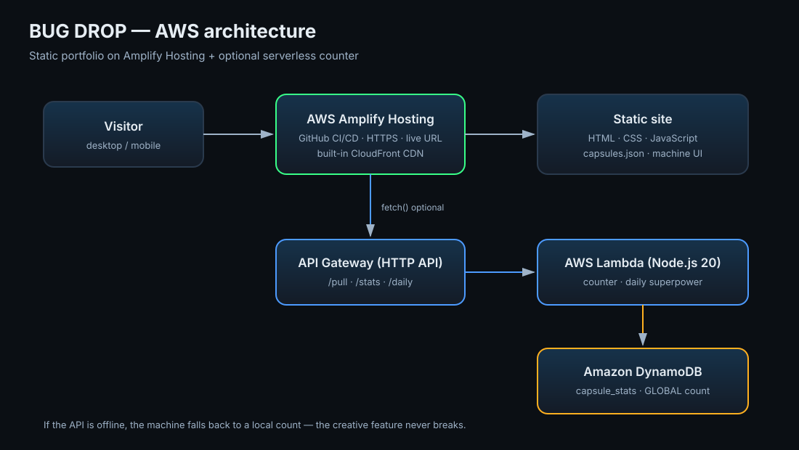

# BUG DROP — The Superpower Vending Machine

A personal portfolio for the **AWS Student Builder Challenge: Build Your Tech Superpower**.
Instead of listing skills, BUG DROP dispenses the **superpowers I earned from real bugs**:
every capsule opens as an incident postmortem (incident → root cause → fix → lesson → the
project it made possible).

- **Live site:** _add your Amplify URL here after deploy_
- **Repo:** `https://github.com/darshankachare/bugdrop-portfolio`
- **Built with:** HTML, CSS, vanilla JavaScript
- **Hosted on:** AWS Amplify Hosting (+ optional API Gateway / Lambda / DynamoDB counter)



## The creative feature

1. A blinking **"PULL FOR A SUPERPOWER"** hint points at the lever.
2. Pulling the lever shakes the machine and drops a capsule.
3. The capsule opens an **incident postmortem** card with a real bug, its root cause,
   the fix, the lesson, and the project that came out of it.
4. The **third pull unlocks a secret capsule**.
5. The lever is a real `<button>` and works with mouse, touch, keyboard, and screen readers.
6. No camera, no permissions, no external API keys — the feature works even if the
   network API is down.

## Core portfolio sections

- **About Me** — who I am and how I learn.
- **Skills / Tech Superpowers** — powers framed as things earned, not just listed.
- **Projects / Achievements** — projects with the bug stories behind them.

## Project structure

```text
bugdrop-portfolio/
├─ index.html                 # single-page portfolio
├─ assets/
│  ├─ css/style.css           # theme + responsive layout + animations
│  ├─ js/config.js            # API base URL + GitHub link (edit this)
│  ├─ js/machine.js           # vending machine + postmortem modal
│  ├─ js/app.js               # navigation
│  ├─ js/capsules.json        # ← your bug stories live here
│  └─ img/og-cover.svg        # social/cover image (replace with 1200x675 PNG)
├─ backend/
│  ├─ template.yaml           # AWS SAM: HTTP API + Lambda + DynamoDB
│  └─ src/handler.mjs         # /pull /stats /daily
├─ docs/
│  ├─ architecture.svg        # architecture diagram for the submission
│  ├─ screenshots/            # put your screenshots here
│  └─ SUBMISSION.md           # write-up ready to paste into Builder Center
├─ .github/workflows/ci.yml   # GitHub Actions: lint + link check + Lighthouse
├─ amplify.yml                # Amplify Hosting build config
├─ package.json               # dev tooling only (not needed at runtime)
└─ README.md
```

## 1. Run locally

```bash
npm install
npm run serve      # http://localhost:8080
```

Or with no dependencies:

```bash
python3 -m http.server 8080
```

> Open it through a server, not `file://`, so `capsules.json` can be fetched.

## 2. Make it yours

Edit **`assets/js/capsules.json`**:

```json
{
  "capsules": [
    {
      "id": "c01",
      "superpower": "The 2AM Debugger",
      "bug": "What actually broke.",
      "cause": "Why it broke.",
      "fix": "How you fixed it.",
      "lesson": "What you now always do.",
      "project": "What it helped you build.",
      "evidence": "commit / screenshot / link"
    }
  ],
  "secret": { "id": "secret", "superpower": "...", "bug": "...", "cause": "...", "fix": "...", "lesson": "...", "project": "...", "evidence": "..." }
}
```

Also update:

- `index.html` — name, About text, skills, projects, GitHub links.
- `assets/js/config.js` — `github` URL and, after backend deploy, `apiBase`.

## 3. Deploy to AWS Amplify Hosting (required)

1. Push this folder to a **public** GitHub repository.
2. AWS Console → **Amplify** → **Create new app** → **Host web app**.
3. Connect GitHub → choose the repo and the `main` branch.
4. Amplify reads `amplify.yml` automatically → **Save and deploy**.
5. Copy the live URL (`https://main.xxxxxxxx.amplifyapp.com`).
6. In Amplify → **App settings → Rewrites and redirects**, no change needed for a
   single-page static site.
7. Optional: **App settings → Previews** to build pull requests, and **Domain management**
   for a custom domain.

Keep the app running through **November 23** (judging window).

## 4. Optional AWS serverless counter

Adds a real serverless backend to the creative feature: a global "capsules pulled"
counter and a daily superpower.

```bash
cd backend
sam build
sam deploy --guided
# Stack name: bugdrop-api
# AllowedOrigin: https://main.xxxxxxxx.amplifyapp.com
```

Then copy the **ApiBaseUrl** output into `assets/js/config.js`:

```js
window.BUGDROP_CONFIG = {
  apiBase: "https://abc123.execute-api.us-east-1.amazonaws.com",
  github: "https://github.com/darshankachare"
};
```

Push again; Amplify redeploys. The machine calls:

| Method | Path | Purpose |
| --- | --- | --- |
| `POST` | `/pull` | Atomically increments the global counter |
| `GET` | `/stats` | Reads the global counter |
| `GET` | `/daily` | Returns a deterministic "superpower of the day" |

If the API is unreachable, the site silently falls back to a local count — the
creative feature never breaks.

### AWS services used (for the write-up)

- **AWS Amplify Hosting** — build + deploy from GitHub, HTTPS, live URL.
- **Amazon CloudFront** — global CDN delivered by Amplify.
- **Amazon API Gateway (HTTP API)** — the `/pull`, `/stats`, `/daily` endpoints.
- **AWS Lambda (Node.js 20)** — counter and daily logic.
- **Amazon DynamoDB** — `capsule_stats` table, atomic counter item.
- **AWS IAM** — least-privilege role generated by SAM.
- **Amazon CloudWatch** — Lambda logs.
- **AWS Budgets** — $5 cost alarm (set this in the console).

## 5. CI/CD

- **Continuous deployment:** every push to `main` triggers an Amplify build and deploy.
- **Pull request previews:** enable in Amplify → Previews.
- **GitHub Actions (`.github/workflows/ci.yml`):**
  - `html-validate` — HTML correctness and accessibility hints
  - ESLint — JavaScript
  - Stylelint — CSS
  - Linkinator — broken local links
  - Lighthouse CI — performance, accessibility, best practices, SEO

Run locally:

```bash
npm run lint
npm run serve
npm run links
npm run lighthouse
```

## 6. Submitting

Fill the Builder Center **Create a project** form using `docs/SUBMISSION.md`.
You need:

- Live AWS URL
- Public GitHub repo URL
- Write-up + screenshots (portfolio and AWS implementation)
- Tags: `aws-amplify`, `javascript`, `serverless`, `aws-lambda`, `student-builders`

## License

MIT — see [LICENSE](LICENSE).
